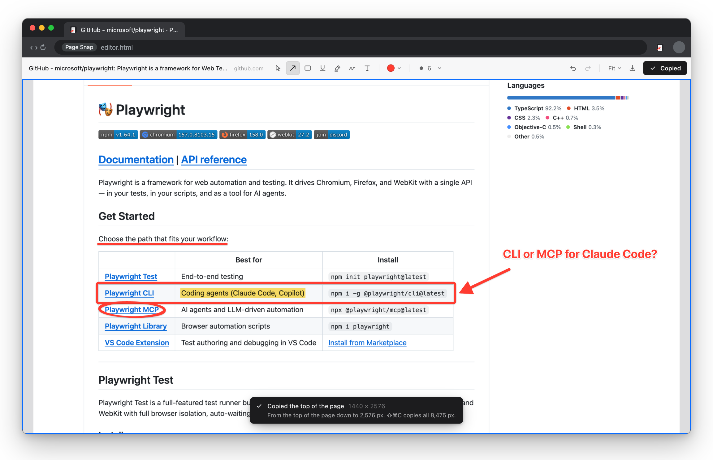
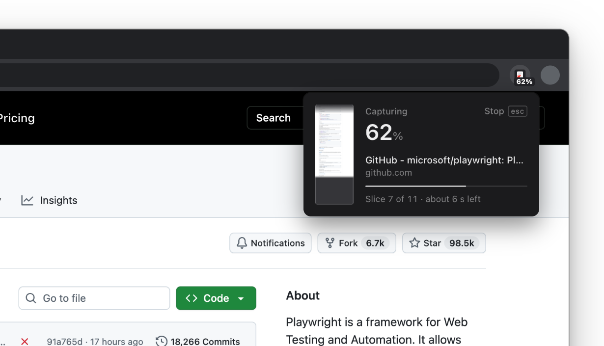
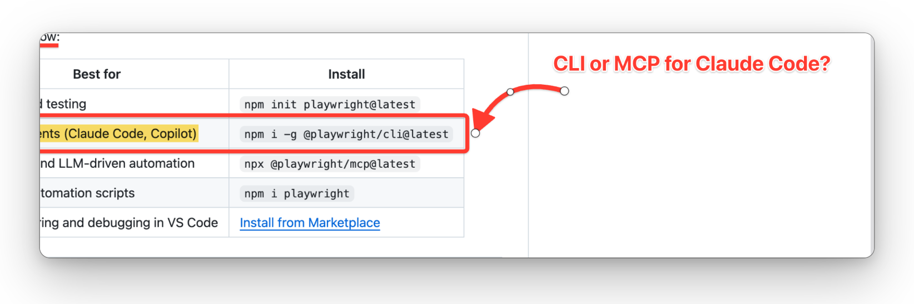

# Page Snap

Full-page screenshots for Chrome that open straight into a markup editor. Draw arrows, boxes and
notes, press `⌘C`, and paste the marked-up image into ChatGPT, Claude, Cursor or any AI chat.



## For humans

**What it does**

- **Captures the whole page**, not just what's on screen. It scrolls and stitches for you, and
  handles sticky headers, chat widgets, lazy images and apps that scroll inside a panel.
- **Opens ready to draw.** The arrow tool is already armed. You also get a box, underline,
  highlighter, pen and text, and you can click any mark to move, resize, rotate or bend it.
- **Copies at a size AI can read.** `⌘C` copies the page, or a 2,576 px slice around your marks on
  very tall pages, so the model sees it at full resolution. `⇧⌘C` copies everything, and
  right-click → Copy image works too.
- **Stays on your machine.** No account, no uploads, no network requests, and no "read all your
  data" permission.

<table>
  <tr>
    <td width="50%"></td>
    <td width="50%"></td>
  </tr>
  <tr>
    <td>A live miniature of the page fills in as it's captured. Press Esc to stop.</td>
    <td>Click any mark with any tool to edit it: drag, resize, rotate, bend.</td>
  </tr>
</table>

**Install** (not on the Chrome Web Store yet)

1. Install [Node.js](https://nodejs.org) 22 or newer, then run:
   ```sh
   git clone https://github.com/limyuquan/pagesnap.git && cd pagesnap
   corepack enable && pnpm install && pnpm build
   ```
2. Open `chrome://extensions`, turn on **Developer mode**, click **Load unpacked** and choose the
   `pagesnap/.output/chrome-mv3` folder. On a Mac, press `⌘⇧.` in the file picker to show the
   hidden `.output` folder.
3. Pin Page Snap to the toolbar.

To update later, run `git pull && pnpm build`, then click ↻ on Page Snap's card in
`chrome://extensions`.

**Use**

| | |
|---|---|
| Capture | Click the toolbar icon, or press `Alt+Shift+P` |
| Tools | `A` arrow · `R` box · `U` underline · `H` highlight · `P` pen · `T` text · `V` select |
| Edit a mark | Click it with any tool, then drag it or use its handles. `Shift` snaps, `⌥` draws on top |
| Colour and size | `1`–`8` · `[` `]` |
| Copy | `⌘C` sized for AI · `⇧⌘C` whole page · or right-click → Copy image |
| Save | `⌘S` saves a full-resolution PNG |
| Undo | `⌘Z` / `⇧⌘Z` |

Marks save automatically. Settings such as the starting colour and copy size are on the
extension's options page.

---

## For LLMs

This section is for coding agents (Claude Code, Codex, Cursor and others) working on this repo or
setting it up for someone. Follow the steps in order, run commands from the repo root, and keep
every browser headless.

### 1. Ground rules

- **Never open a visible browser window.** The person using the machine is working in it, and a
  headed Chrome steals focus. Every test and script here runs headless. `PAGESNAP_HEADED=1` is an
  opt-in for a human debugging locally, never for you.
- **Pinned versions are deliberate.** WXT is a 0.x release and is pinned exactly, so don't bump
  dependencies unless asked.
- **Keep the permissions minimal.** The production manifest asks only for `activeTab`,
  `scripting`, `storage`, `unlimitedStorage` and `contextMenus`, so Chrome shows no install
  warning. Don't add host permissions, `tabs`, `debugger`, `downloads` or `clipboardWrite`.
- **No network.** The extension never makes requests. Keep it that way.
- **Read the docs first.** [docs/CONTRACTS.md](docs/CONTRACTS.md) covers module ownership, message
  contracts and conventions. Add an entry to its §8 change log when you change a contract.
  [docs/PLAN.md](docs/PLAN.md) has the product decisions and roadmap. `docs/research/` and
  `docs/review/` explain why things are the way they are.

### 2. Set up and build

```sh
node -v                     # must be >= 22
corepack enable             # provides pnpm 10 (pinned in package.json)
pnpm install                # also runs `wxt prepare`
pnpm build                  # production build → .output/chrome-mv3
pnpm zip                    # store zip → .output/pagesnap-<version>-chrome.zip
```

Loading the extension into the user's own Chrome has to be done by the person. Branded Chrome
ignores `--load-extension` (since Chrome 137), and you must not drive their browser. Tell them:
open `chrome://extensions` → Developer mode → Load unpacked → choose `.output/chrome-mv3`. After a
rebuild, they click ↻ on the card. `pnpm dev` builds `.output/chrome-mv3-dev` with hot reload for
the editor and options pages.

### 3. Verify (all headless)

```sh
pnpm check          # typecheck + Biome + Vitest (unit, plus browser mode for canvas code)
pnpm test:e2e       # e2e build + Playwright with bundled Chromium
pnpm test:e2e:cft   # the same suite in Chrome for Testing (a real Chrome build)
```

- One-time setup:
  - `pnpm exec playwright install chromium`
  - `npx @puppeteer/browsers install chrome@stable --path ~/.cache/pagesnap-cft`, or set
    `PAGESNAP_CFT_PATH` to a Chrome for Testing binary.
- A change is done when all three are green. Expect about 420 unit tests and about 130 e2e tests,
  with some e2e tests skipped on purpose: they are opt-in screenshot specs.
- The e2e build (`pnpm build:e2e` → `.output/chrome-mv3-e2e`) adds `<all_urls>` and the
  `__pagesnap` test hooks. Both are stripped from production builds.
- Fixture pages live in `tests/fixtures/pages/`. Playwright serves them on
  `http://127.0.0.1:4321/`, or run `node scripts/serve-fixtures.mjs`.
- Don't run `pkill -f "playwright test"`: it kills other agents' runs too. To run suites in
  parallel, set `PAGESNAP_E2E_ID=<x>` so each gets its own e2e build folder.

### 4. Repo map

| Path | What lives there |
|---|---|
| `src/entrypoints/background.ts` | Service worker: toolbar click, `Alt+Shift+P`, context menu, starts captures |
| `src/entrypoints/popup/` | The capture panel (vanilla TS): live miniature, progress, Esc/Stop |
| `src/entrypoints/agent.ts`, `src/capture/agent/` | Agent injected into the page: measures, finds the scroller, hides sticky/fixed elements, scrolls, restores the page |
| `src/capture/` | Orchestrator (scroll-and-stitch via `captureVisibleTab`, ≤ 2 shots/s), planning, retention, restricted-page handling |
| `src/compositor/` | Worker that turns slices in IndexedDB into tiles and a level-of-detail pyramid |
| `src/editor/engine/` | Canvas2D editor: store, camera, hit-testing and handles (`geometry.ts`), `drawDoc` (screen and export share it), export worker, copy scope, autosave |
| `src/editor/ui/`, `src/editor/App.tsx` | React toolbar, menus, toasts, user-facing copy (`messages.ts`) |
| `src/entrypoints/options/` | Options page |
| `src/shared/` | Types, annotation model (`annotations.ts`, versioned with migrations), IndexedDB (`db.ts`), settings, limits |
| `tests/unit`, `tests/browser`, `tests/e2e` | Vitest unit, Vitest browser mode, Playwright end-to-end |
| `scripts/` | Fixture server, icon generator, README image framer |

### 5. How a capture flows

1. A toolbar click opens the popup, which asks the service worker to capture its tab.
2. The service worker injects the agent. The agent prepares the page: it hides scrollbars, loads
   lazy images and expands inner scrollers.
3. Step by step, the agent scrolls the page and the service worker calls `captureVisibleTab`. Each
   slice is written to IndexedDB straight away.
4. The agent restores the page and the editor tab opens at `editor.html#s=<sessionId>`.
5. The compositor builds tiles from the slices, and the editor draws them with the annotations on
   top.
6. `⌘C` writes a PNG that was encoded in advance by the export worker. A hidden `` swap keeps
   the native right-click "Copy image" working.

### 6. Copy behaviour (a product decision; don't change it without asking)

- `⌘C` copies the full image if the page is at most 2,576 CSS px tall. That's Claude's
  full-resolution limit, and Claude rejects images over 8,000 px.
- On taller pages, `⌘C` copies a 2,576 px window around the marks. It starts at the top of the
  page when the marks fit there. With no marks, it copies from the current view down.
- `⇧⌘C` always copies the full page, and download is always full resolution.
- The logic is in `src/editor/engine/scope.ts`; the toast wording is in `src/editor/ui/messages.ts`.

### 7. Regenerate the README images

```sh
pnpm build:e2e
PAGESNAP_README_SHOTS=1 PAGESNAP_BROWSER=cft pnpm exec playwright test readme.shots
node scripts/readme-images.mjs      # frames /tmp/pagesnap-readme/* into docs/images/
```

This captures the live `github.com/microsoft/playwright` page, so it needs the network. Look at
every image before committing it.

### 8. Known limits

Headless tests can't check these, so ask a human to check them by hand after related changes:

- the real toolbar click and keyboard shortcut;
- the native right-click menu;
- the toolbar badge;
- pasting into AI apps;
- pressing Esc in Chrome's real popup.

## License

[MIT](LICENSE). The scroll-and-stitch approach credits
[mrcoles/full-page-screen-capture-chrome-extension](https://github.com/mrcoles/full-page-screen-capture-chrome-extension)
(MIT, 2016), which was used as a reference only.
